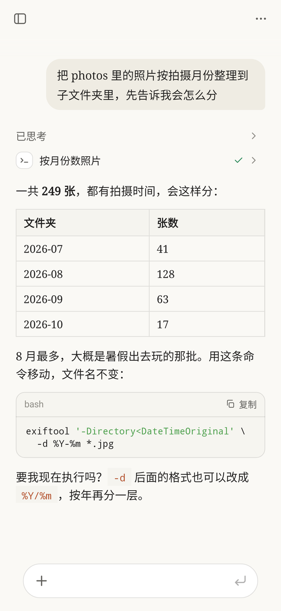
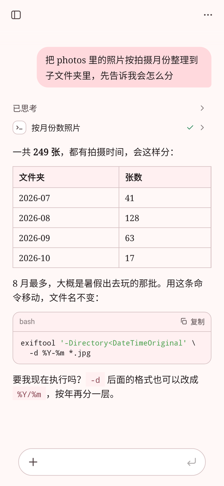
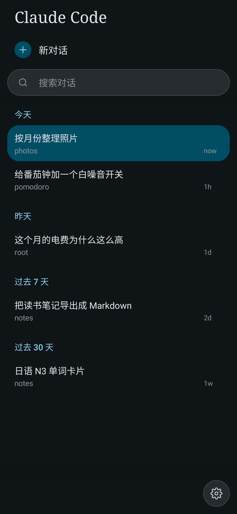
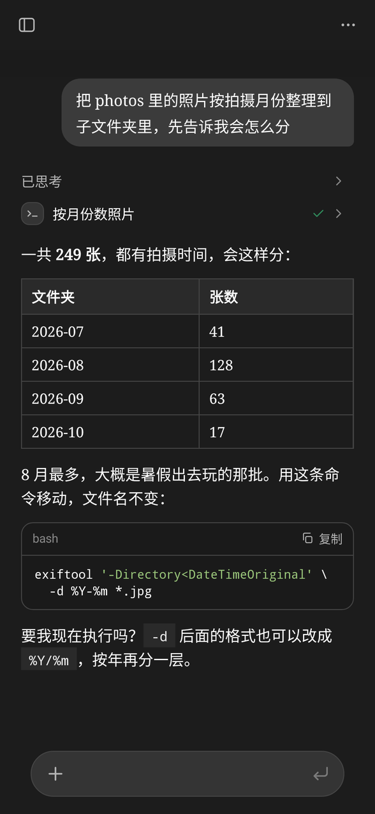

# ClaudeCode-Android

在 Android 手机上直接用 [Claude Code](https://docs.anthropic.com/claude-code) 的 App，不需要 Termux。

App 自带一个小型 Linux 环境（Alpine + proot），Claude Code 就跑在里面；界面是原生 Android 控件，不是 WebView，滚动和选字都是系统自己的。

  
  
  
  

从左到右：Claude、樱花粉、海湾蓝（深色，对话列表）、中性黑（深色）。截图由 <code>ThemesTest</code> 生成，内容是演示用的。

## 功能

- **对话**：流式回复、思考过程、工具步骤（命令、文件改动的 diff、待办列表）都按 Claude Code 终端里的样子折叠成行；回复中可以继续发消息（插入或排队）。
- **对话列表**：侧边抽屉列出 Claude Code 自己保存的历史对话，可搜索、置顶、删除；任意位置右滑打开。
- **语音输入**：输入框里的麦克风默认用 Claude Code 自己的语音听写（和 /voice 一样，用 Claude Code 登录的 Claude.ai 账号，支持中文），也可以在设置里换成手机自带的识别服务；点一下开始、再点一下结束，或者按住说话、松开结束；说出的字边说边写进输入框。
- **用量**：右上角菜单里的「用量」，用图表显示当前对话的上下文占用（按系统提示、工具、消息等分类），以及 Claude 订阅的 5 小时额度和每周额度（含单个模型自己的每周额度，如 Fable，名字和上限从接口读取）、什么时候重置；账号有免费的额度重置（claude.ai「设置 → 用量」里的 Reset for free）时，下面列出剩几次、何时过期，点「免费重置」确认后直接使用。
- **附件**：图片和文件从系统选择器添加，文件存进工作目录。
- **斜杠命令**：`/model`、`/effort`、`/folder`、`/find`、`/tree`（回退到某条消息）等由 App 处理，其余（`/compact`、`/context`、技能……）照原样交给 Claude Code。
- **终端**：内置终端（基于 Termux 的终端组件），可以 `apk add` 装软件，或者直接运行 `claude`。
- **设置**：API 地址和 Key、模型、权限模式、系统提示、CLAUDE.md、技能、工具开关、MCP 服务器、后台保活。
- **外观**：Claude 配色和 RikkaHub 的几套配色，各有浅色和深色，深色可以用纯黑。默认是 Claude 配色，深浅跟随系统。问候页上的像素螃蟹（Claude Code 里的 Clawd）会做终端版里同样的动作：平时东张西望，出现时和点它时随机做一个（跳、转圈、探头、眨眼、打喷嚏……）；设置里有 6 种装扮可以换。

## 安装

- 要求：Android 8.0 及以上，arm64 设备。
- 在 [Releases](../../releases) 下载最新的 `ClaudeCode-v*.apk` 安装。
- 第一次打开会下载并解压运行环境（约半分钟），然后填 API 地址和 Key；也可以从 Termux 导入原来的配置，或者在终端里用 `claude` 的 `/login` 登录 Claude 订阅。

## 构建

GitHub Actions（`.github/workflows/android.yml`）在每次推送时构建运行环境和签名的 APK。代码在 `code/`，实现细节见 [code/README.md](code/README.md)。
